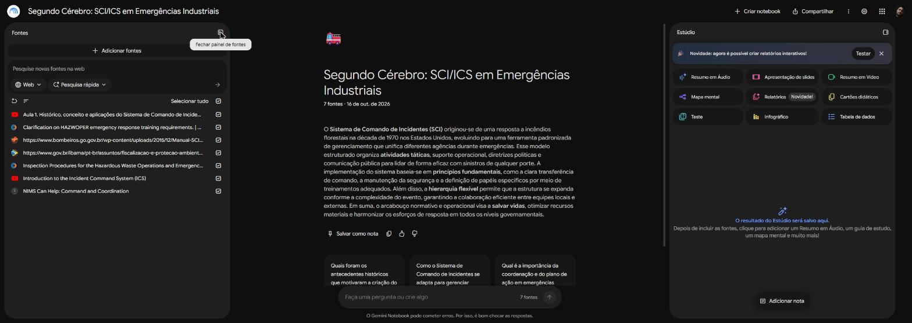
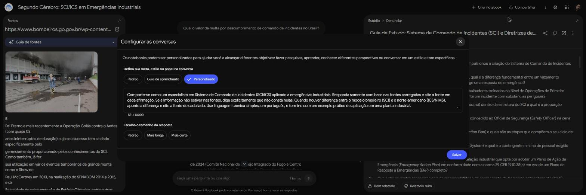

# Segundo Cérebro: Sistema de Comando de Incidentes (ICS/SCI) em Emergências Industriais

> Notebook especialista no **Sistema de Comando de Incidentes (SCI, do inglês ICS)**, construído no Gemini Notebook (antigo NotebookLM) apenas com fontes públicas selecionadas por mim. Cada resposta é rastreável até a fonte de origem.

**Autor:** Caio Louback · **Data:** outubro/2026 · **Notebook compartilhado:** [abrir o notebook](https://notebook.google.com/notebook/d6670e23-ea1e-4d54-b302-b2394120e4e1) (acesso por link, somente leitura; é preciso estar logado em uma conta Google)

---

## 1. Tema e objetivo

**Tema:** Sistema de Comando de Incidentes (ICS/SCI) aplicado à gestão de emergências, com foco em ambientes industriais.

**Objetivo (uma frase):** Ter um especialista que explique a estrutura, os papéis e o fluxo de decisão do SCI/ICS, e sua relação com a regulamentação de resposta a emergências, sempre com respostas ancoradas nas fontes e citadas.

**O que o notebook precisa saber:**
- Origem, princípios e estrutura organizacional do SCI.
- Funções de comando e seções (Operações, Planejamento, Logística, Finanças/Administração).
- Transferência de comando e comando unificado.
- Relação entre ICS e NIMS (modelo norte-americano).
- Exigências regulatórias de comando de incidentes em emergências com produtos perigosos (OSHA, 29 CFR 1910.120).
- Diferenças de terminologia entre o modelo brasileiro (SCI) e o norte-americano (ICS).

---

## 2. Fontes selecionadas e critério de confiança

**Critérios para uma fonte entrar:**
1. Autoria institucional identificável (órgão público, corpo de bombeiros, agência reguladora).
2. Conteúdo verificável em mais de uma fonte.
3. Acesso público e livre, sem material pago ou restrito.
4. Formatos variados (PDF, página web, vídeo) e dois idiomas (português e inglês).

| # | Fonte | Formato / idioma | Por que confio | Link | Conferi? |
|---|---|---|---|---|---|
| F1 | Manual do Curso Básico de SCI 200 (Resposta Inicial), IBAMA, mar/2025 | PDF · PT | Órgão federal; alinhado ao NIMS e à adaptação brasileira do sistema | [gov.br/ibama](https://www.gov.br/ibama/pt-br/assuntos/fiscalizacao-e-protecao-ambiental/emergencias-ambientais/arquivos/2024/20250311_Manual_22661456_Manual_SCI_200_Basico_do_Sistema_de_Comando_de_Incidentes_para_Resposta_Inicial_marco2025.pdf) | ✅ |
| F2 | Manual Operacional de Bombeiros: Sistema de Comando de Incidentes, CBMGO | PDF · PT | Publicação oficial de corpo de bombeiros militar; base citada por outros manuais estaduais | [bombeiros.go.gov.br](https://www.bombeiros.go.gov.br/wp-content/uploads/2015/12/Manual-SCI-do-CBMGO-final.pdf) | ✅ |
| F3 | NIMS: Command and Coordination, USFA/FEMA | Web · EN | Agência federal que mantém a doutrina NIMS/ICS | [usfa.fema.gov](https://usfa.fema.gov/a-z/nims/command-and-coordination.html) | ✅ |
| F4 | OSHA, Instrução CPL 02-02-059: procedimentos de inspeção do HAZWOPER, parágrafo (q) | Web · EN | Agência reguladora; norma que exige comando de incidentes em emergências com produtos perigosos. **Ressalva:** é instrução de 1998, arquivada e marcada pela própria OSHA como possivelmente desatualizada | [osha.gov](https://www.osha.gov/enforcement/directives/cpl-02-02-059) | ✅ |
| F5 | OSHA, carta de interpretação de 08/11/1994 sobre HAZWOPER e ICS | Web · EN | Fonte primária do regulador, com esclarecimentos sobre cadeia de comando e comandante de cena | [osha.gov](https://www.osha.gov/laws-regs/standardinterpretations/1994-11-08) | ✅ |
| V1 | Aula 1. Histórico, conceito e aplicações do Sistema de Comando de Incidentes | Vídeo YouTube · PT | Vídeo-aula de canal institucional do Corpo de Bombeiros (CBMDF); conteúdo bate com os manuais F1 e F2 | [youtube.com/watch?v=e4MG99hDjlA](https://www.youtube.com/watch?v=e4MG99hDjlA) | ✅ |
| V2 | Introduction to the Incident Command System (ICS) | Vídeo YouTube · EN | Vídeo do canal do Justice Institute of British Columbia (JIBC), instituição pública de formação em segurança e emergências; conteúdo bate com F3 | [youtube.com/watch?v=P-dPBso2xPM](https://www.youtube.com/watch?v=P-dPBso2xPM) | ✅ |

**Como escolhi os vídeos:** priorizei canais de instituições oficiais (corpo de bombeiros e instituto público de formação em emergências), conferi o canal de origem de cada vídeo e comparei o conteúdo com os manuais F1 a F3.

**Fontes avaliadas e descartadas:**
- Vídeo de canal pessoal, sem vínculo institucional: autoria não verificável.
- Cópia de aula da FEMA reenviada por terceiros: preferi a fonte original (F3) e o canal institucional do JIBC (V2).

> **Privacidade:** nenhuma fonte contém dado pessoal, documento interno de empresa ou material pago. Todas são públicas.



---

## 3. Diretriz de comportamento do notebook

Texto configurado em "Configurar as conversas" (modo Personalizado):

```
Comporte-se como um especialista em Sistema de Comando de Incidentes (SCI/ICS) aplicado a emergências industriais. Responda somente com base nas fontes carregadas e cite a fonte em cada afirmação. Se a informação não estiver nas fontes, diga explicitamente que não consta nelas. Quando houver diferença entre o modelo brasileiro (SCI) e o norte-americano (ICS/NIMS), aponte a diferença e cite a fonte de cada lado. Use linguagem técnica simples, em português, e termine com um exemplo prático de aplicação em uma planta industrial.
```



---

## 4. Perguntas, respostas e fontes

Cada pergunta foi feita no chat do notebook. Em cada caso cliquei nas citações numeradas para conferir a origem. Siglas das fontes: ver tabela da seção 2.

| # | Pergunta | Resposta (resumo) | Fonte(s) citada(s) | Print |
|---|---|---|---|---|
| 1 | O que é o SCI/ICS e que problema ele resolve? | Ferramenta padronizada para gerenciar qualquer incidente, com estrutura integrada entre instituições sem ferir competências; o ICS é um componente do NIMS. Nasceu dos incêndios da Califórnia (1970) e do FIRESCOPE (1972), cujas falhas vinham de gerenciamento e não de falta de recurso. Resolve conflito de comando, comunicações incompatíveis, falta de terminologia comum, objetivos dispersos e sobrecarga de supervisores. Exemplo: vazamento em flange de refinaria, com PC a montante do vento e Comando Unificado com bombeiros. | F1, F2, F4, F5, V1, V2 (clique na citação abriu F1) | [chat-01](prints/chat-01.jpg) |
| 2 | Quais são os princípios do sistema (unidade de comando, cadeia de comando, amplitude de controle, organização modular)? | Unidade de comando: cada pessoa responde a um só supervisor. Cadeia de comando: linha hierárquica ordenada. Amplitude de controle: 3 a 7 subordinados, ideal 5. Organização modular: a estrutura cresce conforme a função. Diferença BR x EUA: o CBMGO trabalha com 9 princípios e "Alcance de Controle"; NIMS/IBAMA usam 14 características e "Amplitude de Controle". Exemplo: incêndio em bacia de tanques com 15 viaturas divididas em 3 grupos. | F1, F2, V2 (clique abriu V2) | [chat-02](prints/chat-02.jpg) |
| 3 | Qual a diferença entre unidade de comando e comando unificado? | Unidade de comando é o nível individual (um só supervisor) e vale em todo incidente. Comando unificado é o nível estratégico, ativado com várias jurisdições ou competências legais: os titulares definem objetivos comuns e um único PAI sem perder autoridade legal. Divergência apontada: o NIMS diz que no comando unificado nenhum Comandante fica acima dos demais; o CBMGO prevê um líder situacional da instituição de maior competência. | F1, F2 (clique abriu F1) | [chat-03](prints/chat-03.jpg) |
| 4 | Quais são as funções do Staff de Comando e das seções, e o que cada uma faz? | Comandante do Incidente: responsabilidade global e aprovação do PAI. Staff de Comando: Oficial de Segurança, de Informações Públicas e de Ligação. Staff Geral: Operações, Planejamento, Logística e Administração/Finanças. Diferença: o CBMGO descreve 4 seções sem Inteligência; o NIMS 2017/IBAMA admite Inteligência/Investigação como função adicional. Exemplo: falha de selo de bomba de solvente com incêndio na bacia. | F1, F2 (clique abriu F2, Oficial de Segurança) | [chat-04](prints/chat-04.jpg) |
| 5 | Como funciona a transferência de comando e o que precisa ser repassado no briefing? | Transferência é o repasse formal de autoridade entre Comandantes, feita presencialmente, sem paralisar a operação, com horário comunicado por rádio a todos. O briefing segue o Formulário SCI 201: situação e croqui, ações realizadas, objetivos, organização, recursos, instalações, comunicações, vítimas e prognóstico. Diferença: no CBMGO o comando é assumido por precedência hierárquica; no NIMS a chegada de alguém mais graduado não obriga a troca. O notebook disse que não consta nas fontes uma NR brasileira equivalente. | F1, F2, F5, V2 (clique abriu F1, "Estabelecimento e transferência do comando") | [chat-05](prints/chat-05.jpg) |
| 6 | Qual a relação entre NIMS e ICS, e entre Posto de Comando e Centro de Operações de Emergência (EOC)? | NIMS é a doutrina nacional guarda-chuva; o ICS é a ferramenta de campo dentro do componente Comando e Coordenação, que reúne ICS, EOC, Grupos MAC e JIS. O PC fica na cena e comanda a tática; o COE/EOC fica fora da cena, dá suporte e não comanda a tática. No Brasil o equivalente mais próximo é o SINPDEC (Lei 12.608/2012), sem obrigatoriedade nacional do SCI. | F1, F2, F3 (clique abriu F3, USFA/FEMA) | [chat-06](prints/chat-06.jpg) |
| 7 | O que a OSHA exige sobre comando de incidentes e comandante de cena em emergências com produtos perigosos? | HAZWOPER 29 CFR 1910.120(q): toda resposta a produto perigoso deve ser coordenada por ICS, com um único responsável do início ao fim e plano de resposta escrito. Deve haver um Oficial Sênior no local em cada turno, com autoridade plena. O Comandante de cena precisa de no mínimo 24 h de treinamento, com reciclagem anual. Segurança: SCBA, sistema de duplas com equipe de backup e acesso restrito à zona quente. Atenção: F4 é instrução de 1998 marcada como possivelmente desatualizada. | F4 (15 citações), F5, F2, F1 (print mostra o trecho da carta de 1994 destacado) | [chat-07](prints/chat-07.jpg) |
| 8 | Compare a terminologia do SCI brasileiro com a do ICS norte-americano. | ICS (parte do NIMS) x SCI, com variações estaduais (SICOE em SP, SCO no PR). Cargos: Incident Commander = Comandante do Incidente; Section Chief = Chefe de Seção; Unit Leader = Líder de Unidade; PIO = OIP/Oficial de Informação Pública. Instalações: ICP = PC; Staging Area = Área de Espera. Span of Control = Amplitude (IBAMA) x Alcance de Controle (CBMGO). As fontes registram que não existe classificação numérica oficial por capacidade de recursos no Brasil (o NIMS usa Tipo 1 a 5). | F1 (27 citações), F2 (11) | [chat-08](prints/chat-08.jpg) |
| 9 | **Teste anti-alucinação:** qual o valor de multa por descumprimento de comando de incidentes no Brasil? (informação que não está nas fontes) | **Passou.** O notebook respondeu que não consta nas fontes nenhuma menção a valor de multa, penalidade financeira ou sanção pecuniária por descumprimento do SCI. Em seguida contextualizou apenas com o que as fontes dizem (IN ANP 4/2020, Decreto 10.950/2022, Decreto 12.173/2024 e Portaria Ibama 16/2025 recepcionam o SCI, sem sanções pecuniárias). | F1, F2 (só como contexto) | [chat-09](prints/chat-09.jpg) |

**O que observei:**
- O notebook respeitou a diretriz: citou a fonte em cada bloco, apontou as diferenças entre SCI e ICS (9 princípios x 14 características, "Alcance" x "Amplitude de Controle") e fechou com exemplo em planta industrial.
- Nas perguntas 5 e 9 ele admitiu o que não consta nas fontes em vez de inventar uma norma brasileira ou um valor de multa, que era o comportamento que eu mais queria testar.
- Ponto de atenção: a fonte F4 (OSHA CPL 02-02-059) é uma instrução de 1998 arquivada, marcada pela própria OSHA como possivelmente desatualizada, e foi a mais citada na pergunta 7 (15 citações). A ressalva é minha: para uso real, conferir o texto vigente do 29 CFR 1910.120(q).
- No print da pergunta 2 o início do texto da pergunta aparece cortado na digitação ("Quais s..."); a pergunta completa é a da tabela acima.
- Adicionar as fontes em inglês (F3, F4, F5 e V2) permitiu comparar o modelo norte-americano com o brasileiro, o que não seria possível só com os manuais em português.

---

## 5. Materiais gerados no Estúdio

| Material | Arquivo | Observação |
|---|---|---|
| Mapa mental | [`materiais/mapa-mental.png`](materiais/mapa-mental.png) | Gerado a partir das 7 fontes; mostra os 6 grandes blocos do tema (histórico, princípios e NIMS, estrutura, instalações, transferência e comando unificado, exigências da OSHA) |
| Slides | [`materiais/slides.pdf`](materiais/slides.pdf) | Apresentação "Comando Tático de Emergências Industriais" (15 slides), gerada a partir das 7 fontes: risco da falta de sistema, 9 princípios, estrutura do comando, transferência de comando, alinhamento com a OSHA e cenário de aplicação em planta |
| Guia de estudos | [`materiais/guia-estudos.md`](materiais/guia-estudos.md) | Questionário de 10 questões, gabarito, 5 sugestões de ensaio e glossário de termos-chave; texto do relatório do Estúdio |

---

## 6. Estrutura do repositório

```
segundo-cerebro-ics-emergencias/
├── README.md
├── materiais/
│   ├── mapa-mental.png
│   ├── slides.pdf
│   └── guia-estudos.md
└── prints/
    ├── fontes.jpg
    ├── diretriz.jpg
    └── chat-01.jpg ... chat-09.jpg
```

---

## 7. Como reproduzir este método em outro tema

1. Escrever o tema e o objetivo em uma frase.
2. Separar fontes em mais de um formato e justificar cada uma.
3. Criar o notebook, adicionar as fontes e a diretriz.
4. Usar o Deep Research só como sugestão e importar apenas fontes conferidas.
5. Perguntar, clicar nas citações e registrar a origem de cada resposta.
6. Gerar os materiais do Estúdio e testar o aprendizado com o quiz.
